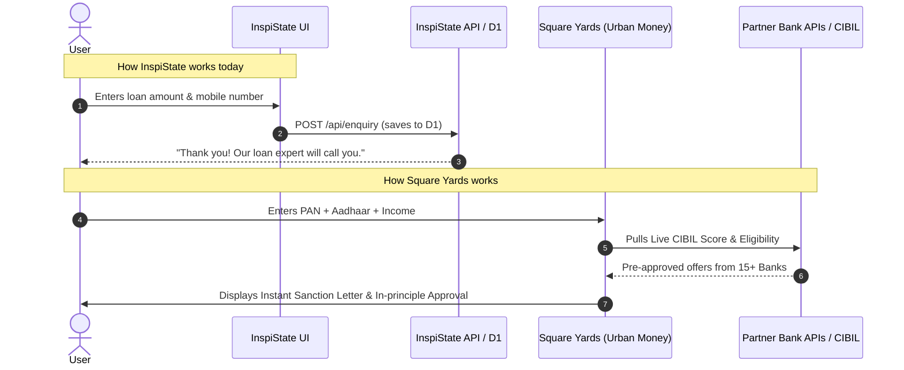
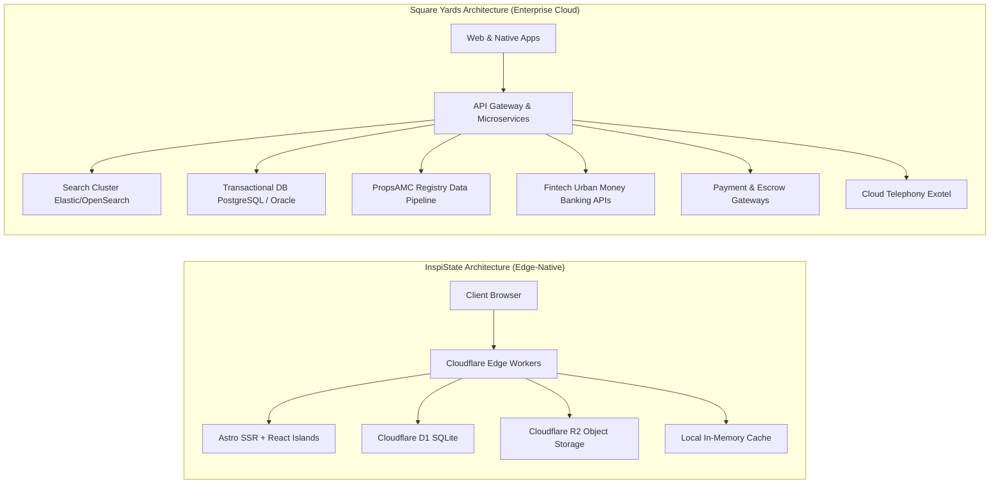

# Comprehensive Feature & Gap Analysis: Square Yards vs. InspiState

> **Document Version:** 1.0.0  
> **Date:** October 2026  
> **Target Comparison:** [Square Yards](https://www.squareyards.com) (Production Ecosystem) vs. **InspiState** (`d:\SY Rep Inspi`)

---

## 1. Executive Summary

Square Yards is not merely a property listing classifieds website (like 99acres or MagicBricks in their early days); it is a **vertically integrated PropTech + FinTech conglomerate**. Its business model spans the entire real estate customer lifecycle:
1. **Search & Discovery** (Consumer Portals in India, UAE, Canada, Australia)
2. **FinTech & Mortgages** (**Urban Money** — digital loan origination and distribution)
3. **Property Data & Asset Intelligence** (**PropsAMC** — government registry records, title search, valuation)
4. **3D Virtual & Spatial Tech** (**PropVR** — digital twins, interactive 3D floor plans, metaverse tours)
5. **Home Interiors & Renovation** (**Interior Company** — 3D design, execution, experience centres)
6. **Property Management & Rentals** (**Azuro** — zero brokerage, digital rent agreements, rent collection)
7. **Broker SaaS Network** (**Square Connect / Smartagent** — 100,000+ channel partner distribution network)

**InspiState (`d:\SY Rep Inspi`)**, by comparison, is currently a **high-performance, edge-first prototype and discovery portal** built on Astro, React Islands, Tailwind, and Cloudflare D1/R2. It possesses a complete foundation for search, SSR crawlable SEO routes, 15 client-side mathematical/financial tools, and 14 lead-capture landing pages for ancillary services. However, it lacks transactional execution, real banking/bureau integrations, public registry data pipelines, and B2B broker tooling.

```mermaid
graph TD
    subgraph "Square Yards Ecosystem (Full-Stack)"
        SY[squareyards.com Discovery] --> UM[Urban Money: Mortgage & Credit]
        SY --> PAMC[PropsAMC: Govt Registry & Title Intel]
        SY --> PVR[PropVR: 3D Digital Twin & VR]
        SY --> IC[Interior Company: 3D Design & Execution]
        SY --> AZ[Azuro: Managed Rentals & Legal]
        SY --> SC[Square Connect / Smartagent: Broker CRM]
        SY --> TX[Digital Booking Engine & Escrow]
    end

    subgraph "InspiState Current State (d:/SY Rep Inspi)"
        IS[InspiState Portal (Astro + D1/R2)] --> IS_Search[Search & Crawlable Facets]
        IS --> IS_Tools[15 Client-Side Calculators]
        IS --> IS_Leads[14 Service Lead Forms]
        IS --> IS_Forum[Community Forum & Reviews]
        IS --> IS_Admin[Basic Admin Moderation]
    end
```

---

## 2. High-Level Comparison Matrix

| Pillar / Dimension | Square Yards (`squareyards.com`) | InspiState (`d:\SY Rep Inspi`) | Status / Gap Level |
|---|---|---|:---:|
| **Primary Discovery & SEO** | Millions of listings across India & International; programmatic SSR & dynamic facets. | SSR dynamic facets (`/buy/{city}/{locality}/{n}-bhk/{type}`), sitemap, meta tags. | ✅ **High Parity** |
| **Financial Calculators** | Full suite (EMI, eligibility, balance transfer, prepayment, tax, affordability). | 15 interactive calculators at `/tools/*`. | ✅ **Feature Parity** |
| **Government Registry Data** | Search actual registered sale deeds, registered prices, circle rates (PropsAMC). | Simulated demo transaction rows in D1; no live registry connection. | ❌ **Major Gap** |
| **Mortgage / Loans (FinTech)** | Direct digital loan origination with 90+ banks, instant sanction, digital KYC. | Informational tables and lead capture forms storing inquiries in D1. | ❌ **Major Gap** |
| **Credit Score Bureau** | Live CIBIL / Experian pull via PAN & SMS OTP. | Self-estimated calculator + referral link to official CIBIL. | 🟡 **Simulated / Gap** |
| **3D & Spatial Visualization** | Interactive 3D master plans, unit selectors, WebGL/VR walkthroughs (PropVR). | 2D floor plans, image carousel, YouTube video walkthrough links. | ❌ **Major Gap** |
| **Online Unit Booking** | Live inventory lock with token advance payments (Razorpay/Cards/UPI). | Orders table exists, but orders halt at `awaiting_payment` (no payment gateway). | ❌ **Major Gap** |
| **Rental Lifecycle (Azuro)** | Digital Aadhaar e-Sign rent agreements with automated stamp duty, online rent pay. | Draft rent agreement generator (client-side PDF) & printable rent receipt. | 🟡 **Draft Only** |
| **Home Interiors** | Custom 3D designer, physical experience centres, milestone manufacturing tracker. | Mathematical cost estimators (`/tools/modular-kitchen`, `/tools/interior-cost`). | 🟡 **Estimator Only** |
| **Channel Partner / Broker SaaS** | B2B app (Square Connect), broker commission tracking, AI listing generator. | Public agent directory page (`/agents.astro`); no broker CRM. | ❌ **Major Gap** |
| **International / NRI Reach** | Dedicated portals for UAE (Dubai), Canada, Australia, multi-currency switcher. | India-focused (top metros only); hardcoded INR (₹ / Lakhs / Crores). | ❌ **Major Gap** |
| **Mobile Apps** | Native iOS & Android apps for consumers, brokers, and interior clients. | Responsive mobile web only. | ❌ **Major Gap** |

---

## 3. Deep-Dive Domain-by-Domain Analysis

### Domain 1: Property Discovery, Search & Project Pages

| Feature | Square Yards Capability | InspiState Current State | What's Missing / What We Need |
|---|---|---|---|
| **Faceted Search** | Highly granular multi-select filters (Price, Area, BHK, Possession, Furnishing, Facing, Verified, Resale vs Fresh). | Complete facet parser in `src/lib/search.ts` with crawlable URLs. | Built and functional. |
| **Autocomplete Search** | Instant multi-entity autocomplete (Projects, Localities, Developers, Landmarks). | Implemented via hero search island. | Built and functional. |
| **Natural Language / AI Search** | Search queries like *"3BHK in Gurgaon under 1.5 Cr near golf course"*. | Rule-based regex parser in `src/lib/nlsearch.ts` and `/api/ask`. | Missing true LLM semantic search (vector embeddings via Cloudflare Vectorize). |
| **Voice Search** | Voice query recognition across platforms. | Browser Web Speech API integrated into search bar. | Limited to Chrome/Edge browsers supporting Web Speech API. |
| **Project Detail Pages** | Overview, Floor Plans, Master Plan, Price List, Construction Progress, Builder Track Record, RERA info. | Complete server-rendered project template at `src/pages/projects/[city]/[slug].astro`. | Missing live construction progress timeline cameras/updates. |
| **Fair Price Meter** | Proprietary algorithm assessing whether asking price is below/at/above market value. | Algorithmic fair-price indicator on property detail page (`/property/[id].astro`). | Built and functional with demo metrics. |
| **Brochure Download** | Lead-gated downloadable PDF brochure generated dynamically with floor plans. | Lead-gated printable brochure generator (`/brochure`). | Built and functional. |

---

### Domain 2: Data Intelligence & Government Registry Records (PropsAMC)

> [!IMPORTANT]
> This is one of Square Yards' biggest moats. They do not rely solely on developer-advertised prices; they index official state government registry transactions.

| Feature | Square Yards Capability | InspiState Current State | What's Missing / What We Need |
|---|---|---|---|
| **Registered Sale Deeds Search** | Search historical registry records by project, tower, and unit number to see what previous buyers actually paid. | ❌ Not available. Transaction tab uses mock seed data. | Integration with State IGR (Inspector General of Registration) APIs or web scrapers. |
| **Registered vs Asking Price Trend** | Visual comparison chart showing gap between developer asking rates and true government-registered rates. | ❌ Not available. Price trends rely on listed asking rates. | Database schema update for `registered_transactions` and comparative charting. |
| **Official Circle Rates** | State government circle rate lookup per square meter across sectors and zones. | ❌ Not available. Stamp duty calculator uses approximate city-level brackets. | Locality-level circle rate lookup table. |
| **Litigation & Dispute Records** | Scans high court and district court records for builder disputes, stay orders, and IBC proceedings. | ⚠️ Lead form at `/services/litigation-search`. | Automated court registry scraping / integration with legal data APIs (e.g. Provakil, LegisEye). |

---

### Domain 3: FinTech & Mortgage Platform (Urban Money)

Square Yards operates **Urban Money**, an RBI-compliant Direct Selling Agent (DSA) and digital lending marketplace.



| Feature | Square Yards Capability | InspiState Current State | What's Missing / What We Need |
|---|---|---|---|
| **Live CIBIL Credit Bureau Pull** | Instant official credit score and detailed credit report generation via PAN and OTP. | ⚠️ Self-reported estimator at `/tools/credit-score` + external link. | Official Experian / CRIF High Mark / CIBIL Partner API agreement. |
| **Direct Bank API Integration** | Real-time rate sync and digital application submission with HDFC, SBI, ICICI, Axis, Kotak, etc. | Static rate comparison table at `/home-loan-interest-rates.astro`. | Banking aggregator APIs (e.g., Setu, Finbox, or direct bank DSA partnerships). |
| **Digital KYC & Income Verification** | DigiLocker integration + Account Aggregator (AA) for 6-month automated bank statement analysis. | ❌ None. | Account Aggregator integration (e.g., Sahamati / OneMoney / Anumati). |
| **Loan Balance Transfer Engine** | Compares current loan terms against competitor banks and calculates exact rupee savings. | Interactive mathematical calculator at `/tools/balance-transfer`. | Calculation is built; automated lender refinancing workflow is missing. |
| **Credit Cards & Personal Loans** | Full financial marketplace for instant credit card approvals, LAP, and business loans. | Static product pages at `/loans/*` and `/credit-cards.astro`. | Affiliate API hooks (e.g., BankBazaar, Paisabazaar partner APIs). |

---

### Domain 4: 3D, Virtual Reality & Spatial Tech (PropVR)

| Feature | Square Yards Capability | InspiState Current State | What's Missing / What We Need |
|---|---|---|---|
| **3D Master Plan Navigation** | Interactive 3D aerial model of projects where users can rotate, zoom, and click specific towers. | ❌ Static master plan images in project tabs. | WebGL / Three.js canvas or integration with Matterport / PropVR embeds. |
| **Interactive 3D Floor Plans** | Dollhouse view of apartments with real dimensions, furniture placement, and sunlight simulation. | 2D architectural layout blueprints. | 3D GLTF/GLB models rendered via `@react-three/fiber` or Babylon.js. |
| **Metaverse / Virtual Reality Tours** | Immersive VR headset compatible walkthroughs of under-construction properties. | YouTube video embed links. | WebXR / 360° panorama image sphere viewer (e.g., Pannellum or Marzipano). |

---

### Domain 5: Digital Transactions & Unit Booking Engine

| Feature | Square Yards Capability | InspiState Current State | What's Missing / What We Need |
|---|---|---|---|
| **Live Inventory Locking** | Users can select specific unit (e.g. Tower B, Flat 1402) and lock it for 48 hours. | ❌ No unit-level inventory tracking. | Developer inventory sync engine + real-time concurrency lock. |
| **Online Token Payment** | Real-time payment gateway integration accepting ₹21,000 to ₹1,00,000 token booking amounts. | ❌ `src/pages/api/orders.ts` marks orders as `awaiting_payment`. | Payment Gateway integration (Razorpay / Cashfree / Stripe). |
| **Digital Escrow Management** | Escrow accounts holding token funds until builder acceptance and agreement execution. | ⚠️ Informational page at `/services/escrow`. | Escrow partner integration (e.g., Castler, Escrowpay). |

---

### Domain 6: Rental Lifecycle & Property Management (Azuro)

| Feature | Square Yards Capability | InspiState Current State | What's Missing / What We Need |
|---|---|---|---|
| **Legally Binding e-Rent Agreement** | Aadhaar biometric/OTP e-Sign + digital e-stamp duty generation via state treasury (NeSL / SHCIL). | ⚠️ Client-side draft generator at `/tools/rent-agreement` (generates un-stamped text). | Digital stamp duty API (Signzy, Leegality, or Zoop.one) + Aadhaar e-Sign. |
| **Online Rent Payment with Credit Card** | Tenants pay monthly rent via UPI/Card to earn reward points; instant landlord receipts. | ⚠️ Offline printable rent receipt generator at `/tools/rent-receipt`. | Payment processing pipeline with tenant-to-landlord bank settlement. |
| **Tenant Background Check** | Automated court litigation scan, identity verification, and police verification filing. | ❌ Not available. | Identity & background verification APIs (IDfy, Karza, Bureau.id). |
| **Landlord Management Portal** | Unified dashboard to track tenant rent payments, lease renewal reminders, and maintenance tickets. | Basic user account page (`/account.astro`) showing saved listings. | Full asset management tenant-landlord dashboard. |

---

### Domain 7: Home Interiors & Renovation (Interior Company)

| Feature | Square Yards Capability | InspiState Current State | What's Missing / What We Need |
|---|---|---|---|
| **3D Room & Kitchen Visualizer** | Interactive browser configurator to swap laminates, acrylics, quartz counters, and hardware. | Mathematical cost calculator at `/tools/modular-kitchen` and `/tools/interior-cost`. | Client-side 3D room canvas with real material swatch libraries. |
| **Experience Centre Booking** | Schedule physical appointments at offline design studios in major cities. | ⚠️ Generic lead form at `/services/home-interiors`. | Calendar appointment booking system (e.g. Cal.com / custom slot picker). |
| **Milestone Manufacturing Tracker** | Real-time Gantt tracker: 3D Signoff $\to$ Factory Cutting $\to$ Delivery $\to$ Installation. | ❌ Not available. | Client project management tracking portal. |
| **Inspiration Gallery & Catalog** | High-resolution photography of real finished client homes with itemized pricing. | Curated categories at `/design-ideas` with AI-generated preview visuals. | Real photography catalog with tagging (budget, sqft, materials). |

---

### Domain 8: B2B Broker & Channel Partner Ecosystem (Square Connect)

Square Yards generates a huge portion of its sales through an army of external real estate brokers using **Square Connect / Smartagent**.

| Feature | Square Yards Capability | InspiState Current State | What's Missing / What We Need |
|---|---|---|---|
| **Broker CRM (Smartagent)** | Dedicated portal & mobile app for brokers to manage their leads, pipeline, and follow-ups. | ❌ Missing. InspiState has only an internal admin moderation panel at `/admin`. | Multi-tenant Agent/Broker dashboard (`/broker/dashboard`). |
| **Commission Invoicing & Payouts** | Automated commission calculation, builder milestone tracking, GST invoicing, and TDS slips. | ❌ Missing. | Commission ledger and payout accounting engine. |
| **AI Marketing Collateral Generator** | Brokers can create branded PDF brochures and WhatsApp flyers with their own logo and phone number. | ❌ Missing. | Automated PDF/Image branding generator with broker watermark. |

---

### Domain 9: Cross-Border, International & NRI Real Estate

| Feature | Square Yards Capability | InspiState Current State | What's Missing / What We Need |
|---|---|---|---|
| **Dedicated International Portals** | Full standalone portals for Dubai/UAE (`squareyards.ae`), Canada, Australia. | ❌ Missing. Top 8 Indian metropolitan hubs only. | Multi-country routing (`/ae/en`, `/in/en`) and country-specific tax rules. |
| **Multi-Currency Engine** | Instant currency converter across all prices (AED, USD, CAD, EUR, GBP, INR). | ❌ Missing. Hardcoded in INR (Lakhs and Crores). | Currency exchange rate worker and format switcher. |
| **NRI Concierge Desk** | Power of Attorney (PoA) facilitation, FEMA compliance, and NRE/NRO banking advisory. | ⚠️ Guide at `/guides` and lead form at `/services`. | Dedicated NRI advisory portal with cross-border legal workflows. |

---

### Domain 10: Platform Infrastructure, Communication & Mobile

| Feature | Square Yards Capability | InspiState Current State | What's Missing / What We Need |
|---|---|---|---|
| **Native Mobile Applications** | Full Android and iOS apps on App Store & Google Play with push notifications. | ❌ Responsive Web App only. | React Native / Flutter mobile app build. |
| **Production SMS / OTP Gateway** | Real SMS delivery (Twilio, Gupshup, Exotel) with international country code selector (+971, +1, etc.). | 🟡 Local mock OTP (code displayed on screen in dev); production requires `SMS_WEBHOOK_URL`. | Production SMS gateway hookup (e.g. MSG91, Twilio). |
| **Virtual Telephony & Number Masking** | Exotel / Knowlarity cloud PBX to connect buyers and sellers without revealing mobile numbers. | Plain click-to-call / view number on listings. | Cloud telephony webhook integration. |
| **Multilingual Localisation** | Support for Hindi and regional languages. | English only. | Internationalization (`astro-i18n` or subpath localization). |

---

## 4. Technical Architecture Comparison



### Key Architectural Differences:
1. **Edge vs Microservices:** InspiState runs on Cloudflare's serverless edge (D1 + R2), which provides sub-50ms page load speeds worldwide with ultra-low hosting costs. Square Yards runs an enterprise microservices infrastructure with dedicated search clusters and database replication.
2. **Search Technology:** InspiState executes SQL `LIKE` and indexed facet lookups in SQLite/D1. Square Yards runs a distributed Elasticsearch cluster with typo-tolerance, synonyms, and weighted relevance ranking.
3. **Data Freshness:** InspiState relies on static seed data (`db/seed-data.ts`). Square Yards has active crawler bots and direct ERP integrations pulling daily updates from builders and brokers.

---

## 5. Prioritized Roadmap: How to Close the Gap

To evolve InspiState from a prototype/discovery portal into a commercially competitive platform like Square Yards, implement features in three distinct phases:

### Phase 1: High-Impact Commercial Foundations (Weeks 1 – 4)
- [ ] **Payment Gateway Integration:** Connect Razorpay or Cashfree to `src/pages/api/orders.ts` to enable paid rent agreements, valuation reports, and feature listing fees.
- [ ] **Production SMS & WhatsApp OTP:** Configure live SMS delivery for `/login` and lead verification via Twilio or MSG91.
- [ ] **Interactive 360° Viewer:** Add a lightweight client-side panorama viewer (Pannellum.js) for virtual property and interior walkthroughs.
- [ ] **Multi-Currency Display:** Add a header currency toggle (`INR ₹`, `AED د.إ`, `USD $`) to appeal to NRI buyers.

### Phase 2: FinTech & Document Legality (Weeks 5 – 8)
- [ ] **Aadhaar e-Sign & Digital Stamp Paper:** Partner with Leegality or Signzy to turn `/tools/rent-agreement` into an official legally enforceable e-stamped agreement.
- [ ] **Live Bureau / Credit Score Hook:** Connect a partner fintech API (e.g. Experian Partner SDK) to provide authenticated credit scores on `/tools/credit-score`.
- [ ] **Semantic Vector Search:** Upgrade `src/lib/nlsearch.ts` to use Cloudflare Workers AI + Vectorize embeddings for natural language property discovery.

### Phase 3: B2B Broker & Data Intelligence (Weeks 9 – 16)
- [ ] **Broker Partner Portal:** Build `/broker/dashboard` with lead routing, commission ledger, and custom branded PDF brochure exports.
- [ ] **Public Registry Data Ingestion:** Build automated parsers for state registration data to show actual historical sale deeds.
- [ ] **3D Floor Plan Interactive Canvas:** Integrate Three.js / WebGL for interactive 3D unit configurations on project detail pages.
